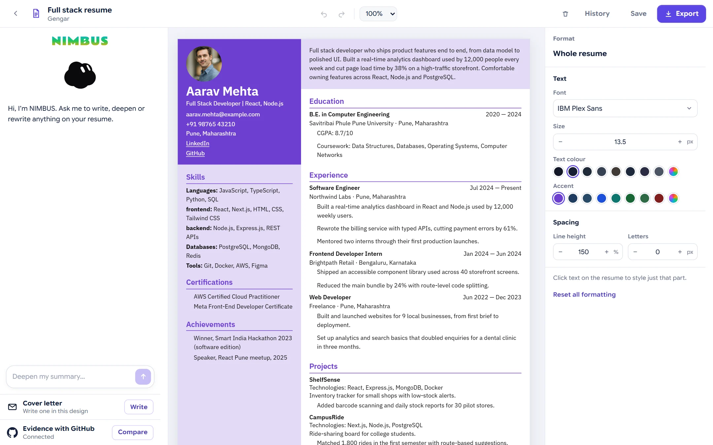
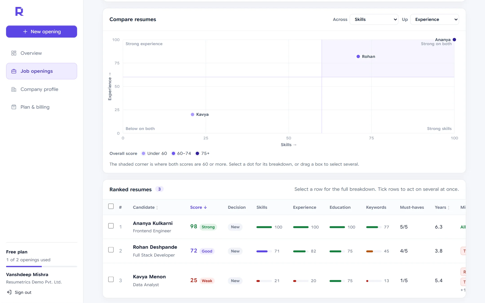
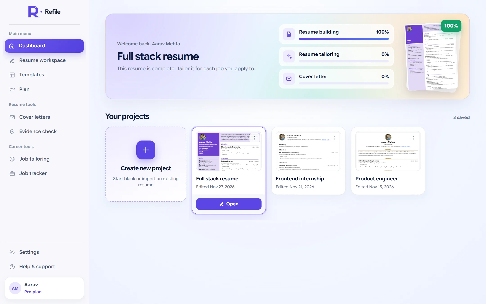
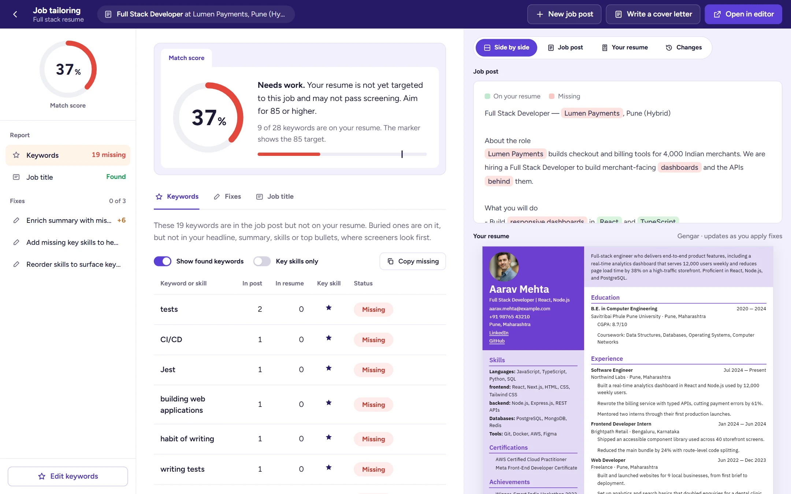
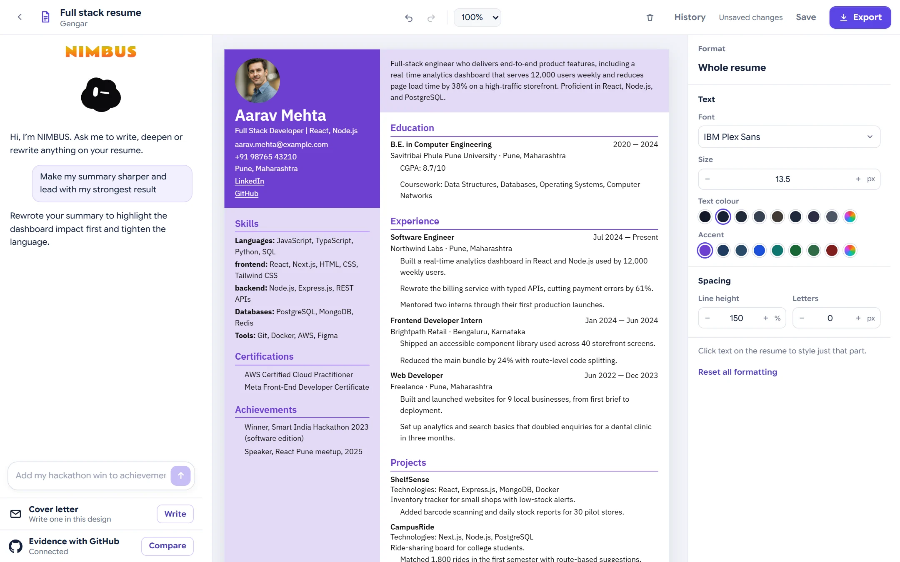
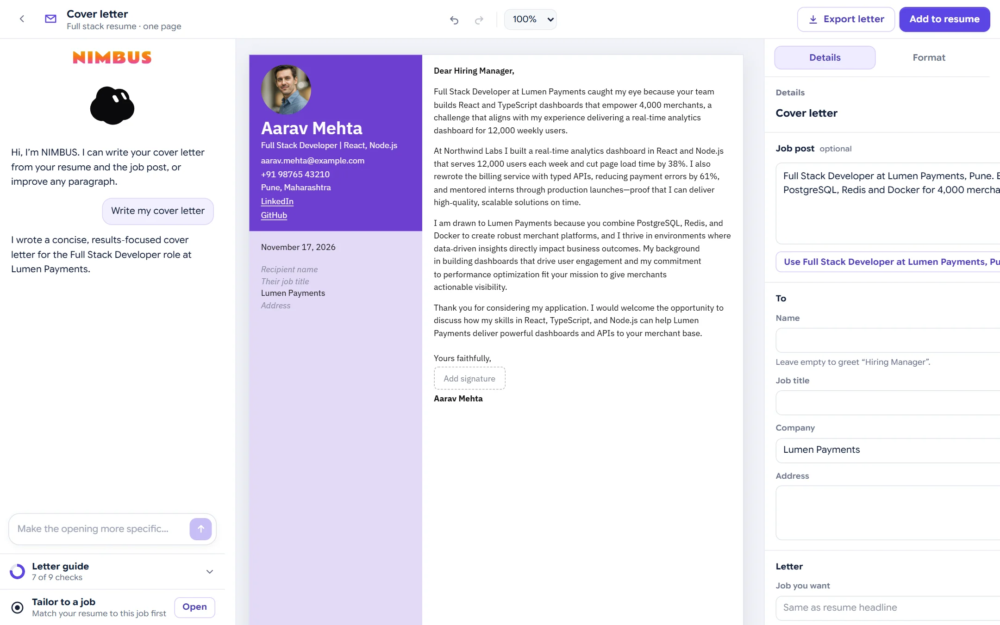
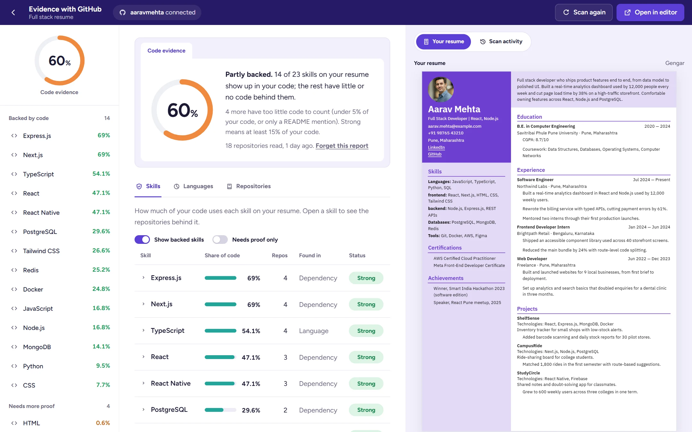
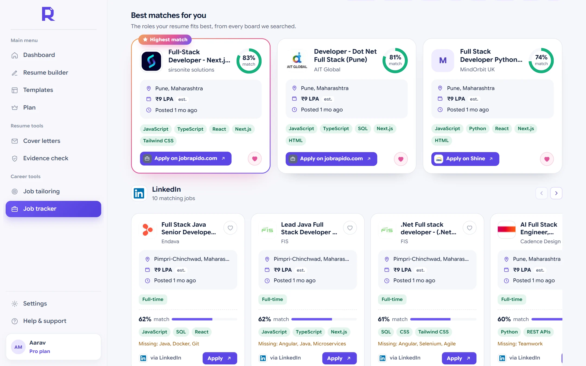
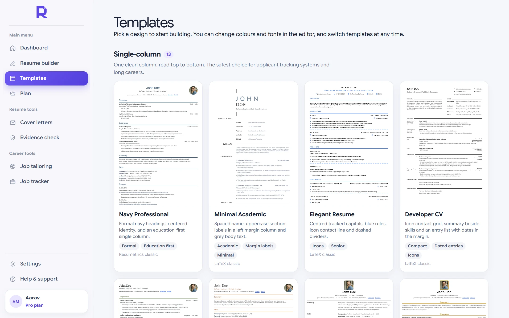
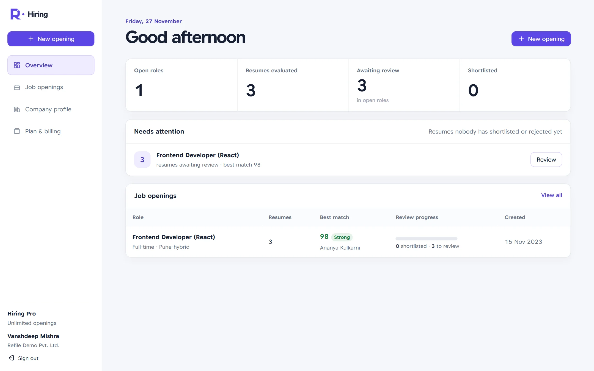

<p align="center">
  <picture>
    <source media="(prefers-color-scheme: dark)" srcset="src/assets/brand/lockup-white.svg">
    
  </picture>
</p>

<p align="center"><b>Resumes built from your real work, tuned to every job.</b></p>

<p align="center">
  
  
  
  
  
  
</p>

<p align="center"></p>

Resumetrics is a resume builder for job seekers in India. You write or import a resume, and an AI assistant called
**NIMBUS** helps you improve it without ever adding facts you didn't give it. You can tailor the resume to a job post,
write a matching cover letter, back up your skills with your own GitHub code, and track the jobs you apply to.

It also has a separate portal for **hiring teams** at `/hr`: recruiters post a job, upload the resumes they received,
and get them scored and ranked against the job.

---

## Contents

- [For job seekers](#for-job-seekers)
- [For hiring teams](#for-hiring-teams)
- [Screens](#screens)
- [Plans](#plans)
- [Tech stack](#tech-stack)
- [Getting started](#getting-started)
- [Project structure](#project-structure)
- [Routes and API](#routes-and-api)
- [Scripts](#scripts)
- [Testing](#testing)
- [Deployment](#deployment)
- [Contributing](#contributing)
- [License](#license)

---

## For job seekers

| | |
| --- | --- |
| **Start your way** | Upload a PDF, Word or text resume, import from LinkedIn, or start from a blank page. |
| **NIMBUS, the AI editor** | Select a bullet, a section or a single line and ask for a change. Every edit is checked against your resume first, so no new numbers, employers, dates or skills appear that you never gave. Bigger requests are shown as a plan of steps you can stop at any time. |
| **24 templates, 131 fonts** | Original layouts with full control over fonts, sizes, colours, spacing and alignment in the format panel. |
| **Job tailoring** *(Pro)* | Paste a job post to get its keywords, a match score and one-click fixes for what your resume is missing. |
| **Cover letters** | NIMBUS writes a letter from your resume and the job post, in the same design as your resume. |
| **Evidence check** | Connect the Resumetrics GitHub App and see each skill on your resume next to its share of your real code (up to 25 recent repositories). |
| **Job tracker** *(Pro)* | Searches 8+ job boards for roles that fit your resume, with salaries, and keeps an applications board from saved to offer. |
| **Never lose work** | Autosave, version history with restore, and export to PDF, DOCX or TXT. |

## For hiring teams

The HR portal (`/hr`) is a separate sign-in for recruiters, kept apart from candidate accounts.

1. **Post a job opening** with must-have and nice-to-have skills, years of experience and education.
2. **Drop in resumes** (PDF, DOCX or TXT, up to 50 per opening). Duplicates are skipped.
3. **See them ranked.** Each resume gets a score out of 100 from skills, experience, education and keywords, with
   weights you can change. A chart compares candidates on any two of those scores.
4. **Decide.** Shortlist or reject in a click (alone or in bulk), turn on blind screening to hide names, and export
   the shortlist as CSV.

Anyone can try it with **Explore the demo** on the HR sign-in page. It opens a private workspace with made-up
candidates, which is deleted after 24 hours.

<p align="center"></p>

---

## Screens

| Dashboard | Job tailoring |
| --- | --- |
|  |  |
| **NIMBUS** | **Cover letters** |
|  |  |
| **Evidence check** | **Job tracker** |
|  |  |
| **Templates** | **HR overview** |
|  |  |

All screenshots are taken from the real app with sample data. To retake them, see
[`scripts/landing-shots/`](scripts/landing-shots/capture.mjs).

---

## Plans

Prices are in rupees and include GST. They live in `shared/plans.js` and `shared/hrPlans.js`.

| Plan | Price | What you get |
| --- | --- | --- |
| Free | ₹0 | 2 resumes, NIMBUS, templates, cover letters, evidence check, export |
| Pro | ₹299/month, ₹2,399/year or ₹4,999 lifetime | Unlimited resumes, job tailoring and the job tracker |
| Hiring (free) | ₹0 | 2 job openings, 50 resumes each |
| Hiring Pro | ₹999/month or ₹9,599/year | Unlimited job openings |

Online payments are not connected yet. Pro can be granted by hand with `scripts/grant-pro.mjs` and
`scripts/grant-hr-pro.mjs`.

---

## Tech stack

| Area | Tools |
| --- | --- |
| Frontend | React 19, React Router 7, Vite 8, Tailwind CSS 4, Lenis (landing scroll), dotLottie |
| Backend | Node.js 24, Express 5, express-rate-limit |
| Auth and data | Firebase Authentication (Google sign-in), Firestore through Firebase Admin |
| AI | Groq (model set in `server/.env.local`), with a `mock` provider for tests and offline work |
| Documents | PDF.js and Mammoth to read resumes; jsPDF and docx to export them |
| GitHub | A GitHub App through Octokit, read-only |
| Job search | JSearch, context.dev and Tavily |
| Hosting | Vercel (static site plus one serverless function for `/api`) |

---

## Getting started

### Requirements

- Node.js 24 and npm
- A Firebase project with Google sign-in and a Firestore database
- A Groq API key (or set `RESUMETRICS_AI_PROVIDER=mock` to try the app without one)

### Set up

```bash
git clone https://github.com/Van5hdeep/RESUMETRICS.git
```

```bash
cd RESUMETRICS
```

```bash
npm install
```

Copy the two example files and fill them in:

- `.env.example` → `.env.local`: the Firebase web config (`VITE_FIREBASE_*`). These are safe to ship to the browser.
- `server/.env.example` → `server/.env.local`: everything secret. Each setting is explained in the file.

The server file needs at least:

```env
RESUMETRICS_AI_API_KEY=your_groq_key
RESUMETRICS_AI_PROVIDER=groq
RESUMETRICS_AI_DEFAULT_MODEL=openai/gpt-oss-20b
FIREBASE_SERVICE_ACCOUNT_PATH=server/secrets/firebase-service-account.json
RESUMETRICS_SESSION_SECRET=a_long_random_value
```

Optional parts:

- **GitHub evidence:** `GITHUB_APP_ID`, `GITHUB_CLIENT_ID`, `GITHUB_CLIENT_SECRET` and `GITHUB_PRIVATE_KEY_PATH`.
  Give the app read access to contents, metadata, issues and pull requests, and set its redirect URL to
  `http://localhost:5173/workspace`.
- **Job tracker:** `JSEARCH_API_KEY`, `CONTEXT_DEV_API_KEY` and `TAVILY_API_KEY`.
- **HR portal:** works out of the box (sign-up and the demo). `RESUMETRICS_HR_EMAIL` and `RESUMETRICS_HR_PASSWORD`
  add one fixed login; `RESUMETRICS_HR_DEMO=0` turns the demo off.

> Never put a secret in a `VITE_` variable, and never commit `.env.local` files or anything in `server/secrets/`.

### Run

```bash
npm run dev:all
```

This starts the site on [http://localhost:5173](http://localhost:5173) and the API on port 8787. Vite forwards
`/api` requests to the API.

---

## Project structure

```text
RESUMETRICS/
├── api/                  Vercel serverless entry that wraps the Express app
├── public/               Static files: favicons, fonts, job-board logos, landing screenshots
├── scripts/              Screenshot harness, font fetcher, plan-granting scripts
├── server/
│   ├── ai/               Provider budget, usage tracking, evals
│   ├── config/           Environment and secrets
│   ├── db/               Firestore stores (users, resumes, evidence, jobs, HR)
│   ├── hr/               HR sessions and the demo workspace data
│   ├── jobs/             Job board search
│   ├── middleware/       Rate limits, security headers, plan checks
│   ├── routes/           ai, resume, nimbus, jd, jobs, github, user, hr
│   └── index.js          Express app
├── shared/               Code used by both browser and server: plans, scoring, fact guard, keywords
├── src/
│   ├── assets/brand/     The logo (icon, lockup, favicon) as SVG
│   ├── components/       Landing page, editor, templates, evidence, job tailoring
│   ├── hr/               The HR portal
│   ├── nimbus/           NIMBUS turns and edits
│   ├── coverLetter/      Cover letter studio
│   ├── jobs/             Job tracker
│   ├── plan/             Plans and upgrade dialog
│   ├── pages/            Landing, login, legal and 404 pages
│   ├── AppPages.jsx      Dashboard, workspace, templates, settings
│   └── main.jsx          Routes
├── tests/                Node tests (no framework) and a Firestore emulator test
└── vercel.json           Rewrites and security headers
```

---

## Routes and API

### Pages

| Path | Who | What |
| --- | --- | --- |
| `/` | Everyone | Landing page |
| `/login` | Everyone | Google sign-in |
| `/privacy`, `/terms` | Everyone | Privacy Policy and Terms of Service |
| `/dashboard` | Signed in | Resumes and progress |
| `/workspace/*` | Signed in | Start, editor, tailoring, cover letter and evidence |
| `/templates`, `/plan`, `/settings`, `/help` | Signed in | Template gallery, plans, settings, help |
| `/jobs` | Signed in, Pro | Job tracker |
| `/hr/*` | HR accounts | HR portal: sign in, register, overview, openings, profile, plan |

### API (`/api`)

| Prefix | What it does |
| --- | --- |
| `/api/ai` | Health check and the signed-in user's AI usage |
| `/api/resume` | Reads an uploaded resume into structured data |
| `/api/nimbus` | One NIMBUS turn (streamed) |
| `/api/jd` | Fixes for job tailoring *(Pro)* |
| `/api/jobs` | Job search, saved jobs and the applications board *(Pro)* |
| `/api/github` | GitHub App connection and the evidence scan |
| `/api/user` | Plan, settings, resumes, versions and saved evidence |
| `/api/hr` | HR sign-in and sign-up, the demo, openings, candidates, decisions and CSV export |

Routes that read or change an account need a Firebase ID token (or, for `/api/hr`, an HR session token). Requests
are rate limited per network address and per user, and each user has a daily AI allowance. Secrets, GitHub tokens
and service-account data stay on the server.

---

## Scripts

| Command | What it does |
| --- | --- |
| `npm run dev` | Vite dev server |
| `npm run server` | Express API on port 8787 |
| `npm run dev:all` | Both together (the API restarts on change) |
| `npm run build` | Production build into `dist/` |
| `npm run preview` | Serve the production build |
| `npm test` | Run every test in `tests/` |
| `npm run test:emulator` | Firestore store tests against the Firebase emulator |
| `npm run ai:ping` | Send one request to the AI provider |
| `npm run ai:eval` | Compare models on the saved AI tasks |
| `npm run fonts:fetch` | Download the resume fonts into `public/fonts/` |

---

## Testing

```bash
npm test
```

The tests use plain Node and an in-memory Firestore, so they need no keys or network. They cover the API routes
(including the HR portal and its sessions), plan limits and quotas, HR and job-post scoring, the NIMBUS fact guard,
GitHub evidence, cover letters and resume saving and versions.

---

## Deployment

The app is set up for Vercel: `vercel.json` serves the built site, sends `/api/*` to `api/index.js`, and adds
security headers. In the Vercel project, set the same variables as the two `.env.local` files. Where there are no key
files, use `FIREBASE_SERVICE_ACCOUNT_JSON` and `GITHUB_PRIVATE_KEY` instead of the `*_PATH` settings, and set
`RESUMETRICS_SESSION_SECRET` (the server refuses to sign sessions without it in production).

---

## Contributing

1. Fork the repository and create a branch (`git checkout -b feat/your-change`).
2. Keep secrets in `server/.env.local` only.
3. Run `npm test` and `npm run build` before you push.
4. Open a pull request against `main`.

## License

MIT. See [LICENSE](LICENSE) and [THIRD_PARTY_NOTICES.md](THIRD_PARTY_NOTICES.md).
